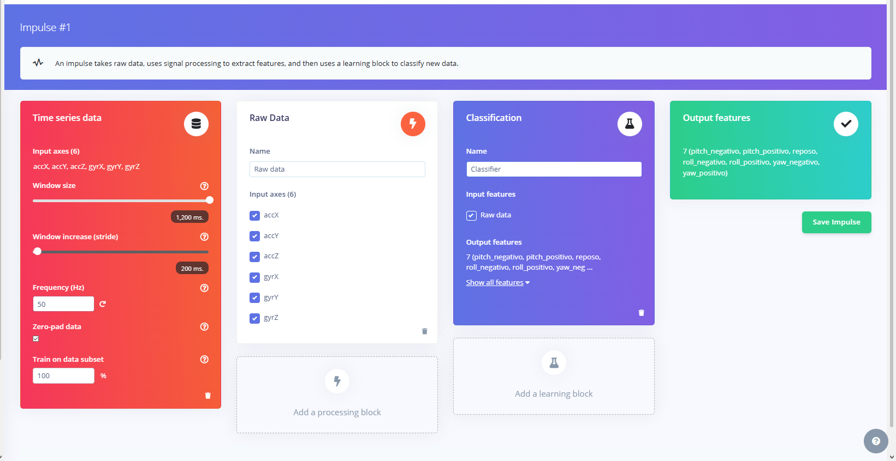
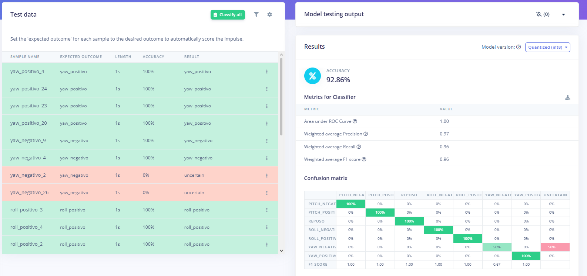

# Reconocimiento de gestos con IMU y Edge Impulse

**Práctica 1 — Redes de Sensores Electrónicos | Máster en Ingeniería Electrónica**

Proyecto de clasificación de movimientos de una **Arduino Nano 33 BLE Sense** mediante una red neuronal entrenada con **Edge Impulse**. El sistema procesa aceleración y velocidad angular para distinguir seis sentidos de giro (Roll, Pitch y Yaw) y una clase de reposo. La predicción se representa mediante el LED RGB integrado en la placa.

> **Alcance:** se reconocen *gestos de giro* (movimiento durante la ventana), no se mide directamente el ángulo de orientación absoluto. La clase Yaw se distingue por la velocidad angular en Z.

## 1. Objetivos

- Registrar datos del acelerómetro y del giróscopo de la IMU.
- Preparar un conjunto de datos multiclase con seis movimientos y reposo.
- Diseñar, entrenar, cuantizar y evaluar un clasificador en Edge Impulse.
- Desplegar el modelo en Arduino y asociar cada predicción a un color del LED RGB.

## 2. Hardware y software

| Elemento | Utilización |
|---|---|
| Arduino Nano 33 BLE Sense (versión original) | Ejecución del modelo y lectura de sensores |
| IMU LSM9DS1 | Aceleración en X/Y/Z y velocidad angular en X/Y/Z |
| LED RGB integrado | Visualización del movimiento clasificado |
| Arduino IDE + `Arduino_LSM9DS1` | Programación y adquisición |
| Edge Impulse Studio | Diseño, entrenamiento, prueba y exportación del modelo |
| Biblioteca exportada `Clasificacion_IMU2_inferencing` | Inferencia integrada en Arduino |

**Nota:** el sketch está preparado para la Nano 33 BLE Sense original con `Arduino_LSM9DS1`, no para la Rev2, que utiliza otros sensores y biblioteca.

## 3. Movimientos y colores

Todos los movimientos se etiquetaron de acuerdo con la referencia de ejes utilizada durante la adquisición. Las denominaciones positivo/negativo corresponden a las **etiquetas del proyecto**; en las capturas utilizadas el signo principal registrado en el giróscopo es el siguiente:

| Etiqueta | Señal dominante | Color del LED |
|---|---|---|
| `roll_positivo` | `gyrX` negativa | 🔴 Rojo |
| `roll_negativo` | `gyrX` positiva | 🩷 Rosa |
| `pitch_positivo` | `gyrY` negativa | 🟢 Verde |
| `pitch_negativo` | `gyrY` positiva | 🟡 Amarillo |
| `yaw_positivo` | `gyrZ` negativa | 🔵 Azul |
| `yaw_negativo` | `gyrZ` positiva | 🟣 Morado |
| `reposo` | Sin giro relevante | Apagado |

Para registrar un gesto se parte de una posición inicial de referencia, se gira alrededor de un único eje y **se evita incluir el movimiento de retorno** en la misma muestra. El retorno se realiza fuera de la captura.

## 4. Adquisición y preparación de datos

Se utilizan seis señales sincronizadas, en este orden:

```text
timestamp,accX,accY,accZ,gyrX,gyrY,gyrZ
```

- `timestamp`: tiempo relativo en milisegundos.
- `accX`, `accY`, `accZ`: aceleración en m/s².
- `gyrX`, `gyrY`, `gyrZ`: velocidad angular en °/s.
- Frecuencia de muestreo: **50 Hz** (20 ms entre muestras).
- Ventana del modelo: **1.200 ms**, equivalente a 60 muestras por canal.
- Denominación de archivos: `movimiento_numero.csv`, por ejemplo `pitch_positivo_5.csv`.

**Procedencia y limitación del conjunto de datos.** Se realizaron capturas experimentales con la placa y se prepararon muestras derivadas mediante transformaciones temporales y aumento sintético de datos para adaptar los gestos a ventanas más cortas. Estas variantes no equivalen a ensayos físicos independientes. Para estimar la generalización, las pruebas definitivas deben realizarse con **capturas reales nuevas**, sin derivados de las mismas señales en entrenamiento y prueba.

## 5. Diseño del impulso



| Ajuste | Valor |
|---|---|
| Entrada | Time series data, 6 canales |
| Frecuencia | 50 Hz |
| Window size | **1.200 ms** |
| Window increase (stride) | **200 ms** |
| Procesamiento | **Raw Data** |
| Aprendizaje | **Classification** |
| Salidas | 7 clases |
| Zero-pad data | Activado en la configuración capturada |

La elección de **Raw Data** permite conservar las muestras temporales, incluido el **signo** de cada componente del giróscopo, crucial para distinguir sentidos opuestos. Una ventana contiene 60 × 6 = **360 valores**. El stride de 200 ms define el desplazamiento de ventana en Edge Impulse; **no implica** que el sketch de Arduino infiera cada 200 ms.

## 6. Evaluación del modelo



La captura de **Model testing** corresponde a la versión del modelo **Quantized (int8)** y muestra:

| Métrica | Valor mostrado |
|---|---:|
| Accuracy | **92,86 %** |
| Weighted precision | **0,97** |
| Weighted recall | **0,96** |
| Weighted F1 | **0,96** |
| Area under ROC curve | **1,00** |

En la matriz de confusión visible, todas las clases excepto `yaw_negativo` aparecen con **100 %** de acierto. Para `yaw_negativo`, un **50 %** se clasifica correctamente y el **50 %** restante aparece como `uncertain`. Estos porcentajes son los mostrados por Edge Impulse para ese conjunto concreto, no una garantía de precisión en funcionamiento real.

Dado que parte de los datos se obtuvo mediante aumento sintético a partir de capturas de origen, las métricas pueden resultar optimistas si el conjunto de prueba comparte señales de origen con el entrenamiento. Es necesario validar con nuevos movimientos físicos de la placa.

## 7. Despliegue en Arduino

1. Exportar el modelo desde **Edge Impulse → Deployment → Arduino library**.
2. Instalar el archivo ZIP en Arduino IDE mediante **Programa → Incluir librería → Añadir biblioteca .ZIP**.
3. Instalar la biblioteca `Arduino_LSM9DS1` y seleccionar la placa **Arduino Nano 33 BLE**.
4. Abrir [`arduino/practica_1_sensores.ino`](arduino/practica_1_sensores.ino), compilar y cargar.
5. Abrir el monitor serie a **115200 baudios** y comprobar las probabilidades y la clase ganadora.

El programa comprueba que el modelo tenga **6 canales**, captura la IMU durante la longitud de ventana fijada por la biblioteca, crea una señal de Edge Impulse y ejecuta `run_classifier()`.

La clase de mayor probabilidad se muestra en el monitor serie y, si supera el **umbral de confianza del 70 %**, se enciende el LED con su color correspondiente. En `reposo` o con confianza inferior al umbral, el LED se apaga. El LED es **activo en bajo**, por eso los valores PWM se invierten con `255 - intensidad`.

El programa actual añade `delay(1000)` después de actualizar el LED. Por tanto, **no utiliza ventanas deslizantes**: la actualización del color depende de la adquisición de una ventana completa, el tiempo de inferencia y esa pausa adicional.

### Código completo (`practica_1_sensores.ino`)

El siguiente es el código cargado en el archivo adjunto a este repositorio:

```cpp

#include <Clasificacion_IMU2_inferencing.h>
#include <Arduino_LSM9DS1.h>
#include <string.h>

// =============================================
// CONFIGURACION
// =============================================

#define CONVERT_G_TO_MS2 9.80665f
#define UMBRAL_CONFIANZA 0.70f

static bool debug_nn = false;

// Buffer para las muestras de la IMU
static float buffer[EI_CLASSIFIER_DSP_INPUT_FRAME_SIZE];

// =============================================
// CONTROL LED RGB
// =============================================

// LED RGB activo en nivel bajo
// 255 = encendido, 0 = apagado

void establecerColor(uint8_t rojo,
                    uint8_t verde,
                    uint8_t azul) {

    analogWrite(LEDR, 255 - rojo);
    analogWrite(LEDG, 255 - verde);
    analogWrite(LEDB, 255 - azul);
}

void apagarLED() {
    establecerColor(0, 0, 0);
}

void actualizarLED(const char* clase, float confianza) {

    if (confianza < UMBRAL_CONFIANZA) {
        apagarLED();
        Serial.println("Confianza insuficiente");
        return;
    }

    if (strcmp(clase, "roll_positivo") == 0) {
        establecerColor(255, 0, 0);       // ROJO
    }
    else if (strcmp(clase, "roll_negativo") == 0) {
        establecerColor(255, 40, 120);    // ROSA
    }
    else if (strcmp(clase, "pitch_positivo") == 0) {
        establecerColor(0, 255, 0);       // VERDE
    }
    else if (strcmp(clase, "pitch_negativo") == 0) {
        establecerColor(255, 255, 0);     // AMARILLO
    }
    else if (strcmp(clase, "yaw_positivo") == 0) {
        establecerColor(0, 0, 255);       // AZUL
    }
    else if (strcmp(clase, "yaw_negativo") == 0) {
        establecerColor(140, 0, 255);     // MORADO
    }
    else {
        apagarLED();                       // REPOSO
    }
}

// =============================================
// SETUP
// =============================================

void setup() {

    Serial.begin(115200);

    // Evitar bloqueo permanente si no hay USB
    unsigned long inicio = millis();

    while (!Serial && millis() - inicio < 2000) {
    }

    // LED RGB
    pinMode(LEDR, OUTPUT);
    pinMode(LEDG, OUTPUT);
    pinMode(LEDB, OUTPUT);

    apagarLED();

    Serial.println("Edge Impulse - Clasificacion IMU2");

    // Inicializar IMU
    if (!IMU.begin()) {
        Serial.println("ERROR: IMU no inicializada");
        while (1) {
            apagarLED();
            delay(100);
        }
    }

    // Comprobar canales del modelo
    if (EI_CLASSIFIER_RAW_SAMPLES_PER_FRAME != 6) {
        Serial.println("ERROR: modelo no tiene 6 canales");
        while (1);
    }

    Serial.println("IMU inicializada");

    Serial.print("Frecuencia: ");
    Serial.print(1000.0f / EI_CLASSIFIER_INTERVAL_MS);
    Serial.println(" Hz");

    Serial.print("Muestras por ventana: ");
    Serial.println(EI_CLASSIFIER_DSP_INPUT_FRAME_SIZE / 6);

    Serial.println("Sistema preparado");
}

// =============================================
// LOOP PRINCIPAL
// =============================================

void loop() {

    // =========================================
    // 1. CAPTURA DE LOS 6 CANALES
    // =========================================

    const unsigned long intervalo_us =
        (unsigned long)(EI_CLASSIFIER_INTERVAL_MS * 1000.0f);

    unsigned long siguiente_muestra = micros();

    for (size_t ix = 0;
         ix < EI_CLASSIFIER_DSP_INPUT_FRAME_SIZE;
         ix += 6) {

        // Esperar al siguiente instante de muestreo
        while ((int32_t)(micros() - siguiente_muestra) < 0) {
        }

        siguiente_muestra += intervalo_us;

        float ax, ay, az;
        float gx, gy, gz;

        // Esperar lecturas disponibles
        while (!IMU.accelerationAvailable() ||
               !IMU.gyroscopeAvailable()) {
        }

        // Leer acelerometro y giroscopio
        IMU.readAcceleration(ax, ay, az);
        IMU.readGyroscope(gx, gy, gz);

        // Aceleracion en m/s2
        buffer[ix + 0] = ax * CONVERT_G_TO_MS2;
        buffer[ix + 1] = ay * CONVERT_G_TO_MS2;
        buffer[ix + 2] = az * CONVERT_G_TO_MS2;

        // Giroscopio en grados/segundo
        buffer[ix + 3] = gx;
        buffer[ix + 4] = gy;
        buffer[ix + 5] = gz;
    }

    // =========================================
    // 2. CONVERTIR BUFFER EN SIGNAL
    // =========================================

    signal_t signal;

    int err = numpy::signal_from_buffer(
        buffer,
        EI_CLASSIFIER_DSP_INPUT_FRAME_SIZE,
        &signal
    );

    if (err != 0) {
        Serial.print("ERROR creando señal: ");
        Serial.println(err);
        apagarLED();
        return;
    }

    // =========================================
    // 3. EJECUTAR CLASIFICADOR
    // =========================================

    ei_impulse_result_t result = { 0 };

    err = run_classifier(&signal, &result, debug_nn);

    if (err != EI_IMPULSE_OK) {
        Serial.print("ERROR clasificador: ");
        Serial.println(err);
        apagarLED();
        return;
    }

    // =========================================
    // 4. MOSTRAR PREDICCIONES
    // =========================================

    Serial.println("\n--- PREDICCIONES ---");

    float mayor_probabilidad = -1.0f;
    size_t mejor_clase = 0;

    for (size_t i = 0; i < EI_CLASSIFIER_LABEL_COUNT; i++) {

        Serial.print(result.classification[i].label);
        Serial.print(": ");
        Serial.println(result.classification[i].value, 4);

        if (result.classification[i].value >
            mayor_probabilidad) {

            mayor_probabilidad =
                result.classification[i].value;

            mejor_clase = i;
        }
    }

    // =========================================
    // 5. IDENTIFICAR MOVIMIENTO
    // =========================================

    const char* movimiento =
        result.classification[mejor_clase].label;

    Serial.print("\nMovimiento detectado: ");
    Serial.println(movimiento);

    Serial.print("Confianza: ");
    Serial.println(mayor_probabilidad, 4);

    Serial.print("Tiempo de inferencia: ");
    Serial.print(
        result.timing.dsp +
        result.timing.classification
    );
    Serial.println(" ms");

    // =========================================
    // 6. ACTUALIZAR LED RGB
    // =========================================

    actualizarLED(movimiento, mayor_probabilidad);
    delay(1000);
}
```

## 8. Limitaciones y mejoras posibles

- Realizar una prueba final con **muestras reales independientes** de todas las clases, sobre todo `yaw_negativo`.
- Comparar una ventana de 1.200 ms con ventanas de menor duración, comprobando su efecto sobre el reconocimiento.
- Implementar un búfer circular y ventanas deslizantes para aumentar la frecuencia de actualización del LED.
- Ajustar el umbral de confianza y estudiar las predicciones `uncertain`.
- Verificar en el dispositivo que el número de muestras y las unidades coinciden con el dataset exportado.

## 9. Referencias

- [Edge Impulse Studio](https://studio.edgeimpulse.com/)
- [Documentación de Edge Impulse](https://docs.edgeimpulse.com/docs)
- [Arduino Nano 33 BLE Sense — documentación oficial](https://docs.arduino.cc/hardware/nano-33-ble-sense)
- [Arduino Nano 33 BLE Sense — guía de uso](https://docs.arduino.cc/tutorials/nano-33-ble-sense/cheat-sheet)
- [Arduino y aprendizaje automático](https://docs.arduino.cc/tutorials/nano-33-ble-sense/get-started-with-machine-learning)

---

**Práctica académica de aprendizaje automático embebido con sensores inerciales.**
