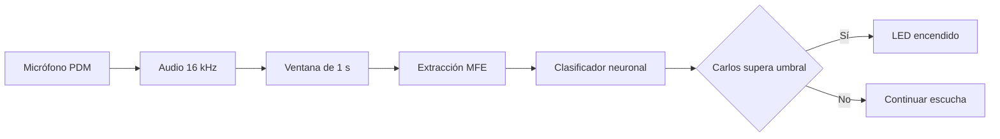
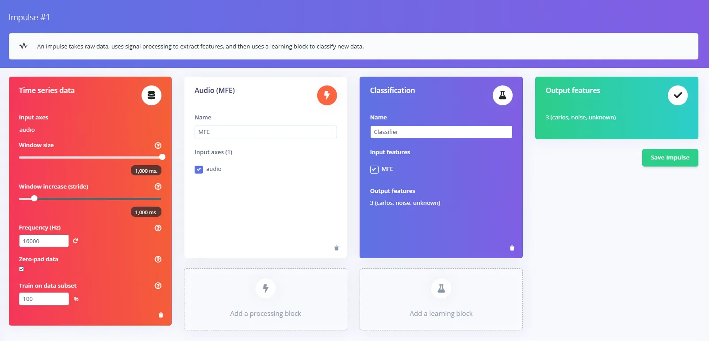
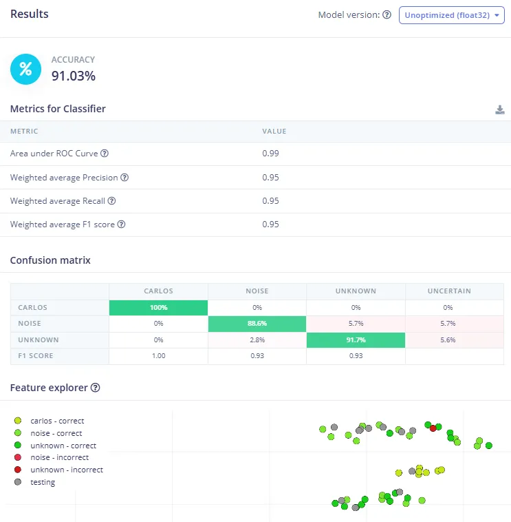

<div align="center">

# 🎙️ TinyML · Reconocimiento de voz

### Detección de la palabra «Carlos» en Arduino Nano 33 BLE Sense


**Machine Learning embebido · Redes de Sensores Electrónicos**  
Máster en Ingeniería Electrónica | Universidad de Zaragoza | 2026–2027

[Objetivo](#-objetivo) · [Arquitectura](#-arquitectura-del-sistema) · [Resultados](#-resultados) · [Despliegue](#-despliegue-en-arduino)

</div>

---

## 🎯 Objetivo

Este proyecto desarrolla un sistema de reconocimiento de palabras clave (*Keyword Spotting*, KWS) mediante Edge Impulse. El objetivo es detectar la palabra **«Carlos»** a partir del audio capturado por el micrófono integrado del Arduino Nano 33 BLE Sense y activar su LED integrado cuando se reconoce la palabra.

El procesamiento y la inferencia se plantean directamente en el microcontrolador, sin depender de un servidor externo durante la ejecución. El proyecto corresponde a las tareas 1 y 2 de la práctica 1 de Redes de Sensores Electrónicos.

## ⚙️ Arquitectura del sistema



| Hardware y software | Función |
|---|---|
| Arduino Nano 33 BLE Sense | Captura y procesamiento local |
| Micrófono digital PDM | Adquisición de voz y ruido ambiental |
| Edge Impulse Studio | Procesamiento, entrenamiento y evaluación |
| Arduino IDE | Compilación y despliegue del firmware |
| LED integrado | Indicador visual de detección |

## 🗂️ Base de datos

El problema se formula como una clasificación multiclase:

| Etiqueta | Contenido | Comportamiento esperado |
|---|---|---|
| `carlos` | Grabaciones de la palabra objetivo | Activar LED si supera el umbral |
| `noise` | Ruido ambiental y sonidos sin la palabra objetivo | No activar LED |
| `unknown` | Otras palabras o expresiones | No activar LED |

Las clases negativas permiten distinguir la palabra objetivo tanto del ruido ambiental como de otras señales de voz. Para mejorar la generalización interesa incluir distintas pronunciaciones, distancias al micrófono y condiciones acústicas, manteniendo separadas las grabaciones de entrenamiento y prueba.

## 🧠 Diseño del impulso

<div align="center">

</div>

| Parámetro | Configuración |
|---|---:|
| Frecuencia de muestreo | 16 000 Hz |
| Tamaño de ventana | 1 000 ms |
| Desplazamiento de ventana (stride) | 1 000 ms |
| Muestras por ventana | 16 000 |
| Zero-padding | Activado |
| Subconjunto de entrenamiento | 100 % |
| Bloque DSP | Audio (MFE) |
| Bloque de aprendizaje | Classification |
| Clases de salida | 3 |

### Extracción de características MFE

El bloque *Mel Frequency Energy* transforma el audio temporal en características de energía distribuidas en bandas de frecuencia según la escala Mel. Así, el clasificador trabaja con una representación espectral de la señal en lugar de utilizar directamente todas las muestras temporales.

El clasificador neuronal recibe estas características y genera una puntuación para cada una de las tres clases. El stride mostrado corresponde a la configuración del impulso en Studio; no determina necesariamente la cadencia de inferencia del firmware continuo.

## 📊 Resultados

<div align="center">
<table>
<tr><td align="center"><b>91,03 %</b><br>Accuracy</td><td align="center"><b>0,99</b><br>AUC ROC</td><td align="center"><b>0,95</b><br>F1 ponderado</td><td align="center"><b>100 %</b><br>Acierto clase Carlos</td></tr>
</table>

</div>

Resultados de la versión **Unoptimized (float32)** mostrada en Edge Impulse:

| Métrica | Valor |
|---|---:|
| Accuracy | 91,03 % |
| Área bajo la curva ROC | 0,99 |
| Precisión media ponderada | 0,95 |
| Recall medio ponderado | 0,95 |
| F1 medio ponderado | 0,95 |

### Matriz de confusión

Filas: clase real. Columnas: predicción del sistema.

| Clase real | Carlos | Noise | Unknown | Uncertain | F1 |
|---|---:|---:|---:|---:|---:|
| **Carlos** | **100 %** | 0 % | 0 % | 0 % | 1,00 |
| **Noise** | 0 % | **88,6 %** | 5,7 % | 5,7 % | 0,93 |
| **Unknown** | 0 % | 2,8 % | **91,7 %** | 5,6 % | 0,93 |

En la evaluación mostrada, todas las muestras de la clase objetivo fueron reconocidas correctamente y ninguna muestra de las otras clases fue clasificada como `carlos`. Los errores se concentran en la separación entre ruido y palabras desconocidas y en las predicciones inciertas (`uncertain`, que no constituye una cuarta clase entrenada).

El *Feature Explorer* permite visualizar la distribución de las características y localizar muestras mal clasificadas. Los resultados son prometedores, aunque no garantizan una detección perfecta en condiciones reales ni equivalen a una medición de rendimiento del modelo desplegado en la placa.

## 🚀 Despliegue en Arduino

1. En Edge Impulse, acceder a **Deployment** y exportar el proyecto como **Arduino Library**.
2. En Arduino IDE, instalar la biblioteca ZIP mediante **Programa → Incluir librería → Añadir biblioteca .ZIP**.
3. Instalar el paquete de placas Arduino Mbed OS Nano y seleccionar Arduino Nano 33 BLE.
4. Abrir el ejemplo de inferencia continua del micrófono incluido con la biblioteca exportada.
5. Incorporar la lógica de activación de `firmware/led_detection.h` según las instrucciones de esa carpeta.
6. Compilar, cargar y comprobar el funcionamiento mediante el LED y el monitor serie.

La lógica propuesta activa el LED durante 500 ms cuando la puntuación de `carlos` alcanza 0,80. Estos valores son parámetros del firmware, no métricas del entrenamiento.

```cpp
if (label == "carlos" && probability >= 0.80f) {
    // Activar el LED durante 500 ms sin bloquear la escucha.
}
```

## 📁 Estructura del repositorio

```text
edge-audio-kws/
├── README.md
├── assets/
│   ├── impulse.png
│   └── resultados.png
└── firmware/
    ├── README.md
    └── led_detection.h
```

## 📝 Conclusiones

El modelo obtenido presenta una accuracy del 91,03 % y un F1 de 1,00 para la palabra objetivo en la evaluación mostrada. La extracción de características MFE y la clasificación en tres categorías permiten plantear una solución de reconocimiento de voz de bajo coste computacional orientada a sistemas embebidos.

Como siguiente paso, resulta importante verificar la robustez en tiempo real, el consumo de memoria, la latencia de inferencia y el comportamiento ante pronunciaciones y ruidos no presentes en el conjunto de datos.

## 🔗 Referencias

- [Edge Impulse](https://www.edgeimpulse.com/)
- [Tutorial Arduino Nano 33 BLE Sense con Edge Impulse](https://docs.arduino.cc/tutorials/nano-33-ble-sense/edge-impulse/)
- Guion de laboratorio: Práctica 1 — Desarrollo de ML embebido con Edge Impulse, Universidad de Zaragoza.

---
<div align="center">
<b>Carlos Gil</b><br>
Máster en Ingeniería Electrónica · Universidad de Zaragoza
</div>
